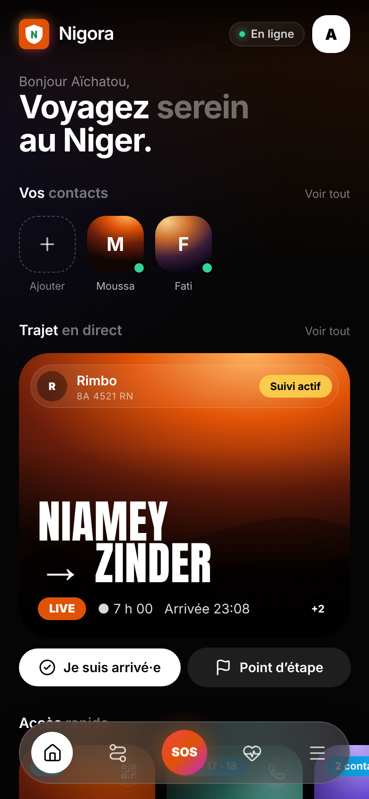
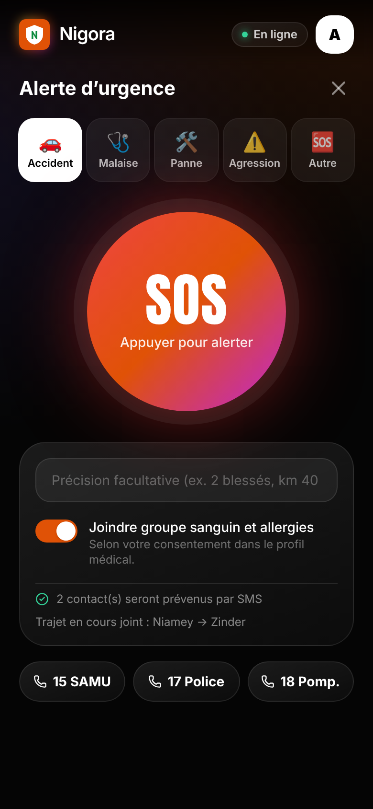
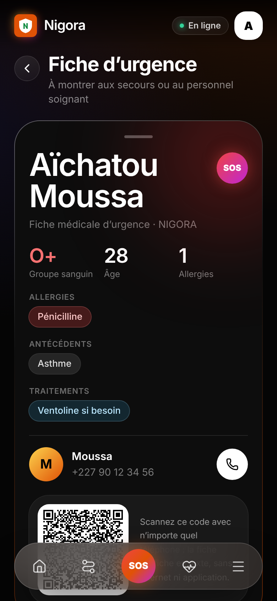
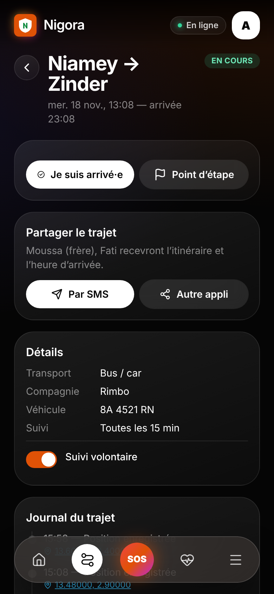
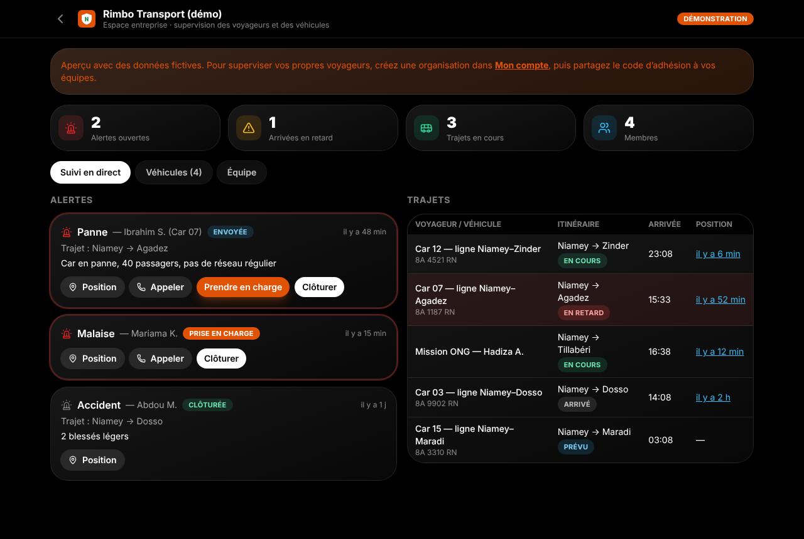

# NIGORA — Sécurité et assistance des voyageurs au Niger

Application web progressive (PWA, installable sur Android et iPhone) qui met en œuvre les quatre capacités du pitch NIGORA, plus les espaces professionnels du modèle économique.

| Pilier du pitch | Dans l’application |
|---|---|
| **1. Préparer et sécuriser les déplacements** | Trajet (départ, destination, heure d’arrivée estimée, compagnie, immatriculation), contacts de confiance, partage par SMS, **suivi volontaire** (position enregistrée à intervalle choisi), points d’étape, « Je suis arrivé·e », **détection de retard** (15 min après l’heure prévue) avec notification et SMS de retard pré-rempli, lien de suivi pour les proches. |
| **2. Alerte SOS** | Bouton SOS avec type d’urgence et compte à rebours annulable, récupération de la position (repli sur la dernière position connue), SMS multi-destinataires vers les contacts, WhatsApp, appel direct SAMU 15 / Police 17 / Pompiers 18, « Je suis en sécurité » pour clôturer, historique. |
| **3. Profil médical d’urgence** | Groupe sanguin, allergies, antécédents, traitements, personne à contacter. **Trois consentements distincts** : joindre au SMS d’alerte, afficher sur la fiche d’urgence, partager avec les partenaires. Fiche plein écran + **QR code lisible sans Internet**, imprimable. |
| **4. Mode connexion limitée** | Tout est stocké sur le téléphone (IndexedDB + copie de secours), application disponible hors ligne (service worker), dernière position connue, alertes par **SMS natif** (réseau GSM suffit), file d’attente **synchronisée automatiquement** au retour d’Internet. |
| **Carte** | MapLibre GL (WebGL). Quatre fonds : **Nuit** (style sombre conçu pour NIGORA : routes nationales en orange, fleuve Niger et koris en bleu, sable du Sahel), **Satellite** (imagerie Esri + routes et noms), **Plan** (OpenFreeMap Liberty), **Relief** (OpenTopoMap). Infrastructures OpenStreetMap en direct : **points d’eau** (puits, forages, bornes, châteaux d’eau, sources — potable ou non, type de pompe), hôpitaux et centres de santé, pharmacies, stations-service, police/gendarmerie, pompiers, garages et dépannage, gares routières, hébergement. Fiche de chaque point (appel, itinéraire, prévenir ses contacts), « à proximité », itinéraire routier du trajet (OSRM) et trace GPS, **enregistrement d’une zone pour l’usage hors ligne**. |
| **Modèle B2B** | **Espace entreprise / transporteur** : alertes en temps réel, trajets en cours et retards, véhicules, équipe, code d’adhésion pour les voyageurs/chauffeurs. Les entreprises ne voient **jamais** les données médicales. |
| **Partenariats autorités / hôpitaux** | **Espace partenaires** : réception des alertes, prise en charge, clôture, journal des changements de statut ; données médicales visibles uniquement avec le consentement du voyageur. |

Les fonctions voyageur sont **gratuites et marchent sans compte**. Les comptes servent à la synchronisation et aux espaces professionnels.

## Aperçu

<p>
   
</p>


## Tests

```bash
npm test            # 21 tests unitaires (logique, OSM, itinéraires, messages, synchronisation, styles de carte)
npm run test:e2e    # 8 parcours complets dans Chrome, réseau simulé (dont hors ligne avec service worker)
```

Les parcours testés : premier lancement, trajet avec itinéraire et arrivée, détection de retard, SOS (annulation, SMS, secours proches, clôture), carte (4 fonds, filtres, clic sur un point), application installée rechargée **sans réseau**, espaces entreprise/partenaires, lien de suivi. Le schéma SQL et ses règles d’accès ont été testés sur PostgreSQL 16.

## Démarrer

```bash
npm install
npm run dev        # http://localhost:5173
npm run build      # production dans dist/
```

En développement (`npm run dev`), sans fichier `.env`, NIGORA tourne en **mode local** : fonctions voyageur actives, espaces entreprise / partenaires en démonstration. La version de production (`npm run build`) est reliée au serveur Supabase.

## Serveur (Supabase)

Le serveur est **déjà en place** : projet Supabase « NIGORA » (région Paris, offre gratuite), relié à l’application par `.env.production`.

- Schéma, règles d’accès et fonctions : `supabase/migrations/` (3 migrations appliquées).
- Testé directement sur le projet : une entreprise ne voit jamais le profil médical ; un partenaire ne le voit qu’avec le consentement du voyageur ; un inconnu ne voit rien ; un voyageur ne peut ni usurper un autre compte ni ajouter de véhicule ; une resynchronisation tardive n’annule pas une prise en charge.

**À régler après la mise en ligne du site** (Tableau de bord Supabase → Authentication → URL Configuration) : remplacer *Site URL* par l’adresse du site (sinon les e-mails de confirmation renvoient vers `localhost`).

Donner l’accès partenaire à un compte (après son inscription), dans le SQL Editor :
```sql
insert into partners (name, kind, region) values ('SAMU Niamey', 'secours', 'Niamey') returning id;
insert into partner_members (partner_id, user_id) values ('<id partenaire>', (select id from auth.users where email = '<e-mail>'));
```

Valider les coordonnées des établissements dans la table `service_directory` (`verified = true`) au fil du pilote.

Pour utiliser un autre projet Supabase : appliquer les migrations dans l’ordre, puis remplacer l’URL et la clé dans `.env.production`.

### SMS envoyés par le serveur (facultatif)

Le SMS part d’abord du téléphone (fonctionne sans Internet). En complément, la fonction `supabase/functions/notify-alert` envoie automatiquement un SMS aux contacts dès qu’une alerte arrive au serveur :

```bash
supabase functions deploy notify-alert --no-verify-jwt
supabase secrets set SMS_PROVIDER=africastalking AT_USERNAME=... AT_API_KEY=... WEBHOOK_SECRET=<secret long et aléatoire>
```

Puis créer un **Database Webhook** (table `alerts`, événement `INSERT`) vers cette fonction avec l’en-tête `x-webhook-secret`. Twilio est aussi pris en charge (`SMS_PROVIDER=twilio`).

## Déploiement

Site statique : Vercel, Netlify ou Cloudflare Pages (`npm run build`, dossier `dist`). Configurer la réécriture de toutes les routes vers `index.html`. Le HTTPS est obligatoire pour la géolocalisation et le mode hors ligne.

## Sécurité des données

- Row Level Security sur toutes les tables ; chaque voyageur ne voit que ses données.
- Entreprises : trajets, positions et alertes de leurs membres, sans données médicales.
- Partenaires : alertes des 7 derniers jours ; médical seulement si `consent_share_with_partners`.
- Une resynchronisation tardive du téléphone ne peut pas annuler une prise en charge en cours.
- Lien de suivi : uniquement si le suivi est activé, prénom seul, expire 24 h après la fin du trajet.

## Services cartographiques utilisés (sans clé d’API)

| Service | Usage | Conditions |
|---|---|---|
| OpenFreeMap | Fond Nuit et Plan (tuiles vectorielles, polices) | Gratuit, sans limite déclarée |
| Esri World Imagery | Fond Satellite | Usage non commercial gratuit ; pour l’offre B2B payante, prévoir un compte ArcGIS ou un autre fournisseur |
| OpenTopoMap | Fond Relief | Usage modéré |
| Overpass API (OpenStreetMap) | Infrastructures | Usage modéré, résultats mis en cache 7 jours sur le téléphone |
| OSRM (serveur de démonstration) | Itinéraires routiers | Démonstration uniquement : héberger son propre OSRM avant la mise en production |

## Limites connues (navigateur)

- Le suivi de position fonctionne **tant que l’application est ouverte** (écran allumé ou en arrière-plan récent). Un suivi permanent écran éteint nécessite l’empaquetage en application native (Capacitor), prévu après le pilote.
- L’envoi du SMS demande une validation dans l’application Messages du téléphone (restriction des navigateurs) ; l’envoi automatique est assuré par la fonction serveur quand Internet est disponible.

## Structure

```
src/
  lib/          état local, synchronisation, messages SMS, géolocalisation, Supabase
  pages/        Accueil, SOS, Trajets, Médical (+ fiche), Contacts, Services, Hors ligne, Compte, Pro, Partenaires, Suivi
  components/   interface, suivi des trajets et synchronisation en tâche de fond
  data/         villes du Niger, annuaire de base, données de démonstration
supabase/       migration SQL (schéma, RLS, RPC) et fonction SMS
```

NIGORA ne remplace pas les services de secours. En danger immédiat : **SAMU 15 · Police 17 · Pompiers 18**.
